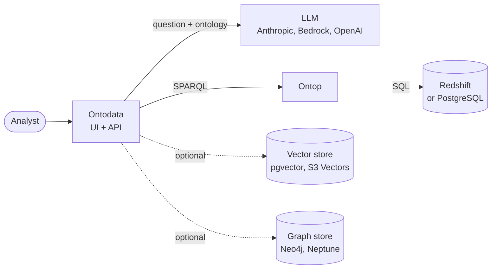

# Ontodata

Ontology studio for SQL data warehouses (Amazon Redshift and PostgreSQL today), built on [Ontop](https://github.com/ontop/ontop).

You describe warehouse tables in business terms. Ontodata turns them into an OWL ontology plus Ontop mappings, and Ontop serves the data as a **virtual knowledge graph**: SPARQL queries are rewritten to SQL and run in the warehouse, so no data is copied. On top of that, an LLM answers plain-English questions.

**Question → SPARQL (LLM) → SQL (Ontop) → your database → insights (LLM)**



## Features

- **Five screens:** LLM settings, data sources, catalog, knowledge graph and Ask.
- **Ontology and mapping from your tables.** Keys and relationships are read from the database, and AI drafts the descriptions.
- **Questions answered with checks.** Every query is validated by Ontop and repaired if it's rejected. You see the SPARQL, the SQL, the rows, a chart and the insights.
- **Pluggable providers:** Anthropic, Amazon Bedrock or OpenAI for the LLM; pgvector or S3 Vectors for retrieval; Neo4j or Neptune for publishing the ontology.
- **Runs locally with sample data**, with no cloud account needed, and ships as one container image.

## Quickstart

You need Docker Desktop and an LLM API key.

```bash
sh ontop/get-jdbc-drivers.sh
```

Then start the stack with the vector store you want:

| Vector store | Command |
|---|---|
| pgvector, in a local container | `docker compose --profile app --profile local --profile vectors up -d --build` |
| Amazon S3 Vectors, in your AWS account | `docker compose -f docker-compose.yml -f docker-compose.s3vectors.yml --profile app --profile local up -d --build` (needs a bucket and `.env`, see [S3 Vectors setup](docs/getting-started.md#s3-vectors-setup)) |

Open http://localhost:4000 and follow [Getting started](docs/getting-started.md) to connect the sample database, build the knowledge graph and ask your first question.

## Documentation

| Page | Contents |
|---|---|
| [Getting started](docs/getting-started.md) | Docker and Node setups, npm scripts |
| [User guide](docs/user-guide.md) | The five screens |
| [How it works](docs/how-it-works.md) | Tables → knowledge graph, and the question pipeline |
| [Architecture](docs/architecture.md) | Components, project layout, API endpoints |
| [Configuration](docs/configuration.md) | Providers, services, secrets, environment variables |
| [Deployment](docs/deployment.md) | Container image, single-host pilot, AWS target design |
| [Deploy with Terraform](docs/deploy-terraform.md) | Create, deploy and remove the AWS test environment with one command each |
| [Deploy on EC2](docs/deploy-ec2.md) | Run on EC2 against Redshift, Neptune, S3 Vectors and RDS pgvector |
| [AWS test plan](docs/aws-testing.md) | Step-by-step checks for Redshift, Bedrock, S3 Vectors and Neptune |
| [Troubleshooting](docs/troubleshooting.md) | Common problems, limits and known issues |
| [Roadmap](docs/roadmap.md) | Phases 1–5 |

## Status

Phase 1 is in progress. Everything has been verified locally against PostgreSQL, pgvector and Neo4j, and the 6-question eval passes 6/6. The AWS services (Redshift, Bedrock, S3 Vectors, Neptune) haven't been tested yet; the [AWS test plan](docs/aws-testing.md) covers them. There's no authentication yet. See the [Roadmap](docs/roadmap.md).
