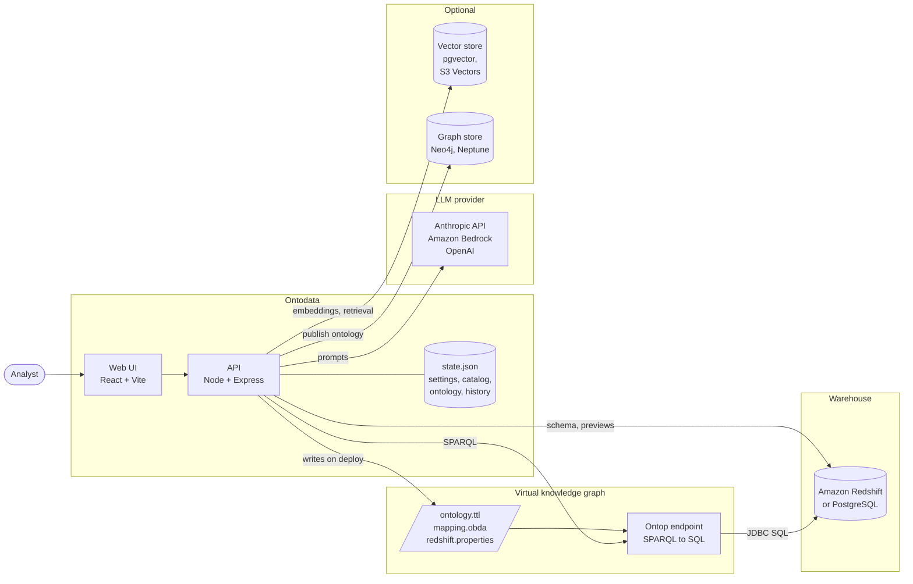

# Architecture

Ontodata is a web app (UI + API) that sits between an analyst, an LLM and a warehouse. The warehouse is exposed as a virtual knowledge graph through [Ontop](https://github.com/ontop/ontop): queries are written against the ontology in SPARQL, rewritten to SQL, and run in the warehouse, so no data is copied.



## Components

| Component | Role |
|---|---|
| **Web UI** | The five screens (see the [User guide](user-guide.md)). In production it's served by the API as static files. |
| **API** | Settings, catalog, ontology generation, the question pipeline and all connectors. Keeps state in `state.json`. |
| **Ontop** | Loads the ontology, mapping and JDBC properties, and answers SPARQL by rewriting it to SQL against the warehouse. Runs in Docker with dev mode on, so it reloads when the ontology or mapping changes. |
| **Warehouse** | Amazon Redshift or PostgreSQL. The local setup uses PostgreSQL with the sample data. |
| **LLM provider** | Writes SPARQL, drafts descriptions and writes insights. Also produces embeddings when a vector store is used. |
| **Vector store** (optional) | Holds embeddings of table and column descriptions, so large schemas can be narrowed to the relevant tables per question. |
| **Graph store** (optional) | Receives the published ontology. Neo4j gets it as a property graph and Neptune as RDF. Instance data is not copied. |

## Design choices

- **Virtual, not copied.** Facts stay in the warehouse and are always current. Ontop translates each query. Only the ontology (classes, properties, relationships) goes to a graph store.
- **The ontology is the interface for the LLM.** The model sees business names and descriptions, not raw table and column names. This is why descriptions matter more than anything else for answer quality.
- **Ontop checks every query.** Every generated SPARQL query is validated by Ontop before it runs, and rejected queries are repaired. See [How it works](how-it-works.md#answering-a-question).
- **Pluggable providers.** The LLM, vector store and graph store each sit behind one small interface (`services/llm.ts`, `services/vectorstore.ts`, `services/graphstore.ts`), so adding a provider doesn't touch the pipeline.

## Project layout

```
ontodata/
├── backend/                 API (TypeScript, Express)
│   └── src/
│       ├── index.ts         HTTP routes
│       ├── store.ts         settings and state (backend/data/state.json)
│       ├── types.ts
│       └── services/
│           ├── llm.ts           Anthropic, Bedrock, OpenAI; embeddings
│           ├── redshift.ts      warehouse metadata and previews (Redshift or PostgreSQL)
│           ├── vkg.ts           ontology + mapping generation, deploy to Ontop
│           ├── ontop.ts         SPARQL execution and SQL reformulation
│           ├── pipeline.ts      question → SPARQL → SQL → insights
│           ├── vectorstore.ts   pgvector, S3 Vectors
│           └── graphstore.ts    Neo4j, Neptune
├── frontend/                UI (React, Vite); src/pages has one file per screen
├── ontop/
│   ├── get-jdbc-drivers.sh  downloads Redshift and PostgreSQL JDBC drivers
│   ├── input/               generated by Deploy (git-ignored)
│   └── jdbc/                driver jars (git-ignored)
├── sample-data/01_retail.sql  7-table retail warehouse, loaded automatically into a new postgres volume
├── scripts/eval-retail.mjs  answer-quality check (npm run eval)
├── deploy/aws/              iam-policy.json, deployer-policy.json, redshift-retail.sql
│   └── terraform/           AWS test environment (docs/deploy-terraform.md)
├── docs/                    this documentation
├── Dockerfile               API + UI image
├── docker-compose.yml       ontop; profiles: app, local, vectors, graph
├── docker-compose.s3vectors.yml  local stack with S3 Vectors instead of pgvector
└── docker-compose.aws.yml   app + ontop only, for EC2 against AWS services
```

## API endpoints

All under `/api`. The UI uses these, and so does `scripts/eval-retail.mjs`.

| Area | Endpoints |
|---|---|
| Settings | `GET /config`, `PUT /config/{llm,redshift,vectorStore,graph,ontop}` (secrets are returned masked) |
| LLM | `POST /llm/test`, `GET /llm/models` |
| Database | `POST /redshift/test`, `GET /redshift/databases`, `GET /redshift/tables?database=`, `GET /redshift/preview?database=&schema=&table=` |
| Catalog | `GET /catalog`, `POST /catalog/tables`, `PUT` / `DELETE /catalog/tables/{schema}/{name}`, `POST /catalog/tables/{schema}/{name}/suggest` |
| Knowledge graph | `GET /vkg`, `POST /vkg/generate`, `PUT /vkg`, `POST /vkg/deploy` |
| Vector store | `POST /vectorstore/test`, `POST /vectorstore/sync` |
| Graph store | `POST /graph/test`, `POST /graph/publish` |
| Questions | `POST /query/sparql` (draft only), `POST /query/run`, `GET /query/history`, `GET /query/history/{id}` |

---

**Related:** [How it works](how-it-works.md) · [Deployment](deployment.md)
