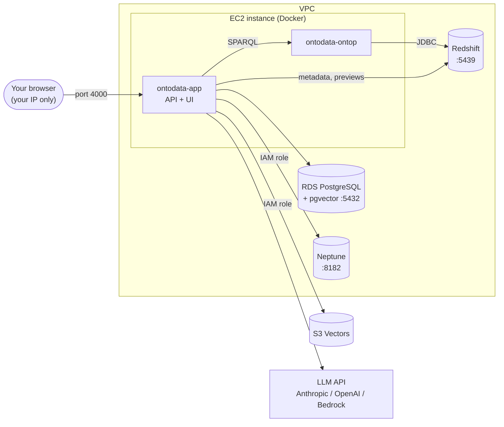

# Deploy on EC2 for AWS testing

**Automated option:** [Deploy with Terraform](deploy-terraform.md) does every step on this page with `terraform apply`, and removes it all with `terraform destroy`. This page explains the same setup by hand.

This guide runs Ontodata as Docker containers on one EC2 instance, connected to **Amazon Redshift**, **Neptune**, **S3 Vectors** and **pgvector on RDS**. It's meant for testing, not production: there's no sign-in, so only your IP can reach the app. For the production design, see [Deployment](deployment.md#option-2-aws-target-architecture).



| Step | What you do |
|---|---|
| [1. Network](#1-network-and-security-groups) | One VPC, security groups between the instance and each service |
| [2. AWS resources](#2-create-the-aws-resources) | Redshift, RDS with pgvector, S3 vector bucket, Neptune |
| [3. IAM role](#3-iam-role-for-the-instance) | Permissions for S3 Vectors and Neptune |
| [4. EC2 instance](#4-launch-the-ec2-instance) | Launch, allow containers to use the role, install Docker |
| [5. Run Ontodata](#5-copy-the-project-and-start-it) | Copy the project, start the containers |
| [6. Configure and test](#6-configure-and-test) | Connect each service in the UI, in order |

## 1. Network and security groups

Put the EC2 instance, Redshift, RDS and Neptune in the **same VPC**. Neptune can only be reached from inside its VPC. The instance needs outbound internet access, through a public subnet or a NAT gateway, for the LLM API, S3 Vectors, Docker Hub and the JDBC driver downloads.

Create a security group for the instance (`ontodata-ec2`), then allow it into each service:

| Security group | Inbound rule |
|---|---|
| `ontodata-ec2` (the instance) | TCP 4000 from **your IP only**. TCP 22 from your IP, or no SSH and use Session Manager instead. |
| Redshift | TCP 5439 from `ontodata-ec2` |
| RDS | TCP 5432 from `ontodata-ec2` |
| Neptune | TCP 8182 from `ontodata-ec2` |

## 2. Create the AWS resources

### Redshift

Use an existing cluster or Serverless workgroup, or create a small Serverless workgroup. Create a read-only user for Ontodata:

```sql
CREATE USER ontodata PASSWORD 'Choose-A-Strong-Password1';
GRANT USAGE ON SCHEMA sales TO ontodata;
GRANT SELECT ON ALL TABLES IN SCHEMA sales TO ontodata;
ALTER DEFAULT PRIVILEGES IN SCHEMA sales GRANT SELECT ON TABLES TO ontodata;
```

Replace `sales` with your schema, and repeat for each schema you'll use. Ontodata only sees tables this user can read.

### RDS PostgreSQL with pgvector

Create an RDS for PostgreSQL instance, version 16 or later. A `db.t4g.micro` is enough for a schema catalog. Turn off public access, and attach the RDS security group. Then, as the master user, run once:

```sql
CREATE DATABASE vectors;
\c vectors
CREATE EXTENSION IF NOT EXISTS vector;
```

The app creates its table on the first index. You can use the master user for testing, or create a user that owns the `vectors` database.

RDS requires SSL by default, so set **SSL → Required** on the pgvector settings.

### S3 Vectors

In the S3 console, create a **vector bucket** in the same region as the instance, for example `ontodata-vectors`. Don't create an index; the app creates one on the first sync with the right dimension.

### Neptune

Create a Neptune cluster with **IAM database authentication turned on**. Neptune Serverless or a small `db.t4g.medium` instance is enough. Attach the Neptune security group. Note:
- the **cluster endpoint**, for example `ontodata.cluster-abc123.us-east-1.neptune.amazonaws.com`
- the **cluster resource ID** (`cluster-ABCDEFGHIJ...`, on the cluster's Configuration tab), for the IAM policy

## 3. IAM role for the instance

[`deploy/aws/iam-policy.json`](../deploy/aws/iam-policy.json) has the permissions for S3 Vectors and Neptune. Replace `REGION`, `ACCOUNT_ID`, `VECTOR_BUCKET` and `NEPTUNE_CLUSTER_RESOURCE_ID`, then create a role for EC2 with that policy:

```bash
aws iam create-policy --policy-name ontodata-test --policy-document file://deploy/aws/iam-policy.json
```

In the IAM console, create a role with **EC2** as the trusted service, attach `ontodata-test` and `AmazonSSMManagedInstanceCore` (for Session Manager), and name it `ontodata-ec2`.

If you'll use **Amazon Bedrock** as the LLM, also allow invoking the Claude model and `amazon.titan-embed-text-v2:0`, and enable those models in the Bedrock console. With an Anthropic or OpenAI key, no AWS permission is needed for the LLM.

Redshift and RDS use a database user and password, so the role needs no permissions for them.

## 4. Launch the EC2 instance

| Setting | Value |
|---|---|
| AMI | Ubuntu Server 24.04 LTS, x86_64 |
| Type | `t3.large` (2 vCPU, 8 GB). Ontop is a Java service and needs about 2 GB. |
| Storage | 30 GB gp3 |
| Network | The same VPC as the services, with outbound internet |
| Security group | `ontodata-ec2` |
| IAM instance profile | `ontodata-ec2` |

**Let the containers use the instance role.** Containers reach the instance metadata service through one extra network hop, so raise the hop limit to 2. Without this, S3 Vectors and Neptune fail with "Could not load credentials".

```bash
aws ec2 modify-instance-metadata-options --instance-id i-0123456789abcdef0 --http-tokens required --http-put-response-hop-limit 2 --http-endpoint enabled
```

**Install Docker** on the instance, over SSH or Session Manager:

```bash
curl -fsSL https://get.docker.com | sudo sh
```

```bash
sudo usermod -aG docker $USER
```

Log out and back in so the group change applies, then check with `docker compose version`.

## 5. Copy the project and start it

From your machine (PowerShell or Git Bash), copy the project without dependencies, local state or generated files. Replace the key file and host:

```bash
tar --exclude=node_modules --exclude=dist --exclude='*/backend/data' --exclude='*/ontop/input' --exclude='*.jar' -czf ontodata.tgz -C F:/projects ontodata
```

```bash
scp -i my-key.pem ontodata.tgz ubuntu@EC2_PUBLIC_IP:~
```

If the project is in a Git repository, `git clone` on the instance works too.

Create `ontop/input` yourself, as the `ubuntu` user, as in the first command below. If Docker creates it, it's owned by root and the app can't write the Ontop files to it.

On the instance:

```bash
tar -xzf ontodata.tgz && cd ontodata && mkdir -p ontop/input
```

```bash
sh ontop/get-jdbc-drivers.sh
```

Optionally, create a `.env` file next to `docker-compose.aws.yml`, so keys don't have to be entered in the UI:

```bash
cat > .env <<'EOF'
AWS_REGION=us-east-1
OPENAI_API_KEY=
ANTHROPIC_API_KEY=
EOF
```

Start the app and Ontop:

```bash
docker compose -f docker-compose.aws.yml up -d --build
```

The first build takes a few minutes. Then open `http://EC2_PUBLIC_IP:4000`.

If you didn't open port 4000, forward it through Session Manager instead and open `http://localhost:4000`:

```bash
aws ssm start-session --target i-0123456789abcdef0 --document-name AWS-StartPortForwardingSession --parameters portNumber=4000,localPortNumber=4000
```

**Using ECR instead of building on the instance:** build and push the image from your machine, then set `ONTODATA_IMAGE` in `.env` to the ECR image URI and run `docker compose -f docker-compose.aws.yml pull app` followed by `up -d`. The instance role then also needs `AmazonEC2ContainerRegistryReadOnly`.

## 6. Configure and test

Connect one service at a time, so a failure points at a single thing. The checks and pass criteria for each are in the [AWS test plan](aws-testing.md).

| Order | Screen | Setting |
|---|---|---|
| 1 | LLM | Provider and key. **Save & test**. |
| 2 | Data sources → Database | Amazon Redshift, the endpoint, port 5439, the `ontodata` user, SSL on. **Save & test**. |
| 3 | Catalog → Knowledge graph | Add tables, check keys and relationships, add descriptions, then **Generate** and **Deploy to Ontop**. |
| 4 | Instance shell | `docker restart ontodata-ontop`. Needed after the first deploy and after any database connection change. |
| 5 | Ask | A few questions. Compare the SQL and rows with the Redshift query editor. |
| 6 | Data sources → Vector store | pgvector: the RDS endpoint, port 5432, database `vectors`, SSL **Required**. Index, then turn on **Use for questions**. |
| 7 | Data sources → Vector store | S3 Vectors: region and bucket, with a different index name. Index, then ask the same questions. |
| 8 | Data sources → Graph | Neptune: cluster endpoint, port 8182, region, IAM auth on. **Publish ontology**. |

Only one vector store is used at a time. Switching the provider and indexing again is how you compare pgvector and S3 Vectors on the same questions.

## Updating and cleaning up

**Update:** copy the new code to the instance and run `docker compose -f docker-compose.aws.yml up -d --build` again. Settings and the catalog are kept in the `appdata` volume.

**Logs:** `docker logs --tail 50 ontodata-app` and `docker logs --tail 50 ontodata-ontop`.

**Costs:** Neptune, Redshift and RDS charge while they run, even when idle. Stop or delete them when you finish testing, and stop the instance. A Redshift Serverless workgroup only charges while queries run.

**Secrets:** database passwords are stored on the instance, in the `appdata` volume and in `ontop/input/redshift.properties`. Use test credentials, and delete the instance and volume when you're done.

---

**Related:** [AWS test plan](aws-testing.md) · [Deployment](deployment.md) · [Troubleshooting](troubleshooting.md)
