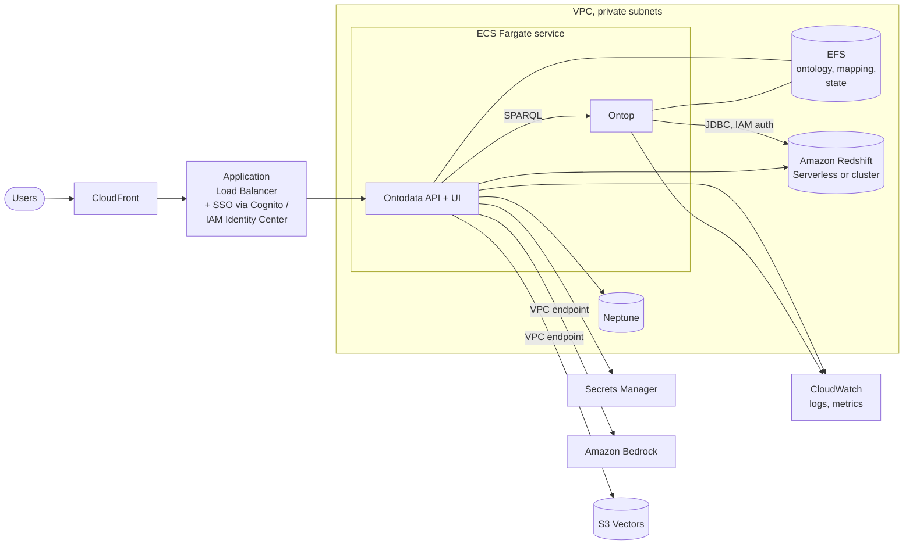

# Deployment

| Option | Status | Use it for |
|---|---|---|
| [Container image](#container-image) | Available | The deployable unit for both options below |
| [Option 1: single host](#option-1-single-host-team-pilot) | Available | A team pilot on one VM |
| [EC2 test setup](deploy-ec2.md) | Available | Step-by-step AWS testing on one EC2 instance |
| [Option 2: AWS](#option-2-aws-target-architecture) | Target design | Production. The infrastructure-as-code isn't written yet. |

## Container image

The repository root `Dockerfile` builds one image with the API and the built UI. It uses Node 22, runs as the unprivileged `node` user and serves port 4000.

```bash
docker build -t ontodata-app .
```

| Path in the container | Mount | Contents |
|---|---|---|
| `/data` | volume | `state.json`: settings, catalog, ontology, history |
| `/ontop-input` | shared with Ontop's `/opt/ontop/input` | generated `ontology.ttl`, `mapping.obda`, `redshift.properties` |

Ontop runs as its own container (`ontop/ontop:5.4.0`) with the JDBC drivers from `ontop/jdbc` mounted in. See `docker-compose.yml`.

## Option 1: single host (team pilot)

Run the containers on one VM with network access to the warehouse, for example an EC2 instance in the same VPC as Redshift. The `app` profile starts the app, and Ontop always starts. Add `vectors` or `graph` if you want those services.

```bash
sh ontop/get-jdbc-drivers.sh
```

```bash
docker compose --profile app up -d --build
```

On the Database tab, enter the Redshift endpoint. After the first deploy, run `docker restart ontodata-ontop` (see [Restarting Ontop](configuration.md#restarting-ontop)).

Before giving others access:

- Put the app behind a reverse proxy with TLS and sign-in. **The app has no authentication of its own yet.**
- Back up the `appdata` volume and `ontop/input/`.
- Pass LLM keys as environment variables (`ANTHROPIC_API_KEY`, `OPENAI_API_KEY`) rather than saving them on screen 1.
- Use a read-only database user for the warehouse connection.

## Option 2: AWS (target architecture)

This is the recommended production layout ([Roadmap](roadmap.md), Phase 5). The container image above is the deployable unit.



| Concern | Recommendation |
|---|---|
| Compute | One ECS Fargate service with two containers: the app image (this repo's `Dockerfile`, pushed to ECR) and `ontop/ontop:5.4.0` with the Redshift JDBC driver. They share the generated files on EFS. |
| Network | Private subnets, Redshift reachable without public access, VPC endpoints for Bedrock, S3 Vectors and Secrets Manager. |
| Identity | SSO in front of the load balancer. Redshift IAM authentication instead of a stored password. A read-only database role. |
| Secrets | Secrets Manager for LLM keys and any remaining passwords, injected as environment variables. Don't use `state.json` for secrets. |
| LLM | Bedrock inside the AWS account, so prompts and data stay within it. |
| Vector and graph stores | S3 Vectors and Neptune as managed options. pgvector on RDS or Aurora works too, with SSL on. |
| Operations | CloudWatch logs for both containers, an audit log of questions and the SQL they ran, and `npm run eval` in CI against a test schema. |

**Still needed:** infrastructure-as-code (CDK or Terraform), Secrets Manager integration, authentication and Redshift IAM auth in the app. All are tracked in the [Roadmap](roadmap.md).

---

**Related:** [Configuration](configuration.md) · [Architecture](architecture.md)
