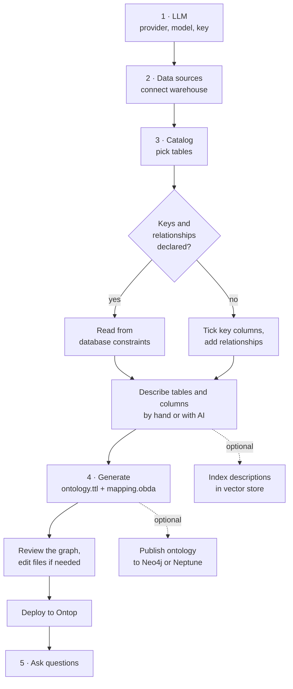
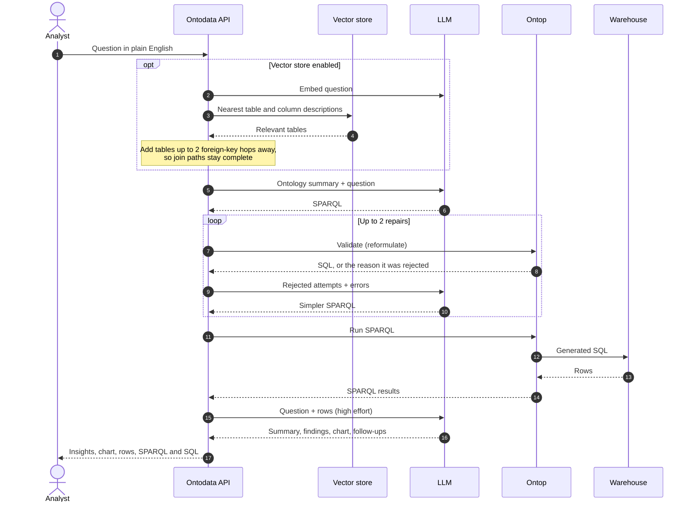

# How it works

There are two flows. First, you turn warehouse tables into a knowledge graph, once per schema. Then you ask questions, as often as you like.

## From tables to a knowledge graph

### How the catalog becomes an ontology and mapping

| Catalog | Ontology | Mapping (Ontop) |
|---|---|---|
| Table | `owl:Class`, e.g. `:Order` | Instance IRIs `data:<schema>/<table>/<key…>`, so **every table needs key columns** |
| Column | `owl:DatatypeProperty` with an XSD range from the column type | One mapping per table with all included columns |
| Relationship (foreign key) | `owl:ObjectProperty`, e.g. `:hasCustomer` | A join, so the object IRI matches the target table's key template |
| Description | `rdfs:comment` | What the LLM reads when it writes SPARQL |

Details:

- **Names:** class names are singular PascalCase versions of the table name (`order_items` → `OrderItem`), and property names are camelCase versions of the column name (`order_date` → `orderDate`). You can rename both on screen 3.
- **Shared property names:** a property name used by several tables, like `regionId`, gets no `rdfs:domain`, so it doesn't wrongly tie those classes together.
- **Column types:** integers map to `xsd:integer`, `numeric` and `decimal` to `xsd:decimal`, floats to `xsd:double`, booleans to `xsd:boolean`, dates to `xsd:date`, timestamps to `xsd:dateTime`, and everything else to `xsd:string`.
- **Column aliases:** source SQL aliases every column to a safe lowercase name, so column names with spaces or capitals work.

Deploying writes three files to `ontop/input/`: `ontology.ttl`, `mapping.obda` and `redshift.properties` (the JDBC connection). Ontop reloads the first two automatically. A change to the third needs an Ontop restart (see [Configuration](configuration.md#restarting-ontop)).

## Answering a question

### Step by step

1. **Retrieve** (only with a vector store): the question is embedded and the nearest table and column descriptions are found. Similarity search finds the tables a question *mentions*, not the ones needed to *join* them. For example, "orders per country" needs Order → Store → Region. So tables up to 2 foreign-key hops away are added too.
2. **Write SPARQL:** the model gets a compact summary of the ontology (classes, properties with types and descriptions, relationships) and the question.
3. **Validate and repair:** Ontop rewrites the query to SQL without running it. If it's rejected, the real error is fetched and the model rewrites the query, seeing every failed attempt. This happens up to 2 times.
4. **Run:** Ontop runs the generated SQL in the warehouse and returns the rows.
5. **Insights:** the model gets the question and up to 100 rows, and returns a summary, key findings, a chart suggestion and 3 follow-up questions.

### Safeguards

- **Automatic SPARQL fixes:** some valid SPARQL can't be translated by Ontop, and the app fixes it automatically. For example, casting a literal such as `xsd:decimal(100)` becomes `100.0`.
- **Prompt rules:** the prompt includes Ontop-specific rules. For example, a calculation that combines aggregates is wrapped in `xsd:decimal(...)`, because without it Ontop fails when the query orders by that column. See [Troubleshooting](troubleshooting.md#ontop-rejects-a-query).
- **High effort for insights:** the insights step always runs at `high` effort or above, whatever the LLM setting. Comparisons across grouped rows went wrong at lower effort in testing.
- **Partial failures:** if insights fail, the rows are still returned. If SPARQL fails, the last attempt is kept so you can edit it by hand on screen 5.

### Answer quality

`npm run eval` runs 6 questions on the sample data and checks key values against known answers. They cover revenue by department, top customers, orders by channel and country, gross margin by category, monthly revenue, and enterprise customers by region. The check passed 6/6 with no vector store, with pgvector, and inside the Docker stack.

---

**Related:** [Architecture](architecture.md) · [User guide](user-guide.md) · [Troubleshooting](troubleshooting.md)
